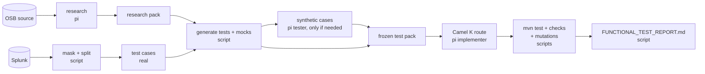

# Functional testing of OSB flows: the approach, the mocks, the proof, and how to run it for any domain

One page to follow. Details: [HOW_IT_WORKS.md](HOW_IT_WORKS.md) (diagrams), [DOMAIN_RUN.md](DOMAIN_RUN.md) (all stages),
[CODEGEN_RUNBOOK.md](CODEGEN_RUNBOOK.md) (route generation and comparing skills).

## 1 The approach in five sentences

1. **Inputs** come from production: the OSB log lines in Splunk that carry the message, masked inside the client network.
   Flows whose logs carry no message get **synthetic** messages built from their schema, with fake values.
2. **Expected results** come from the OSB source: which queues (or reply) each kind of message must reach, the error
   handling and retries; for the message body, what OSB itself logged on its way out, or the original XQuery.
3. **Mocks**: every queue, topic and backend is replaced by a Camel mock endpoint that records what it receives;
   backend replies come from stub files. No broker, no cluster, no OSB, only Java and Maven.
4. **Tests** are generated by a script and frozen before any route exists; they send each message into the Camel K
   route and check the outputs. The tests also have to catch defects put into the route on purpose.
5. **Proof** is one report per domain: per flow the inputs, expected outputs, mocks, results and caught defects.



## 2 Where pi is used, and where not

| Step | Who | Why |
|---|---|---|
| research: read the OSB source, answer 12 questions | **pi** | every flow is written differently; reading XML pipelines, XQuery and schemas needs judgement |
| synthetic messages for scenarios Splunk cannot supply | **script first** (`synth_from_schema.py`, from the XSD/nXSD, no AI); **pi** (tester) only for what the script cannot build | fake values; the scenario fields get the scenario's values |
| Camel K route that the tests run against | **pi** (implementer) | writing code; needed to prove the tests (and for the migration itself) |
| masking, splitting, scenarios, expected outputs, test classes, mocks | script | deterministic; the same input always gives the same tests |
| running the tests, checks K1–K11, mutation check | script + Maven | the judge must not be an AI |
| reports (STATUS, TEST_MATRIX, COVERAGE, FUNCTIONAL_TEST_REPORT) | script | counts from the files, reproducible |

pi never writes or changes a test, an expected result or a report.

## 3 What is mocked, and how

| OSB element | In the test |
|---|---|
| inbound queue / topic subscription | `direct:in`; the subscription filter itself is tested later with a real broker (Dev environment) |
| outbound queue / topic (business service) | `mock:out-<business-service>`: receives exactly the expected messages, none for other scenarios |
| HTTP / SOAP backend whose reply is used | `mock:backend-<name>` answering with `stubs/<name>.json|xml` (shape from the schema, fake values) |
| reply to the caller (HTTP proxies) | the exchange's reply, checked like an output |
| error queue | `mock:out-<error-service>`: original message + error headers |
| backend down / timeout | the mock throws; retries are counted |

## 4 What counts as proof (per flow)

| # | Proof | Shown in the report as |
|---|---|---|
| 1 | inputs exist for every scenario | `real_cases`, `synthetic_cases`, gap "no test cases" |
| 2 | expected outputs come from OSB, not from the new code | `scenarios`, `body_oracle` |
| 3 | every output and backend is mocked | `mocked_outputs`, `reply` |
| 4 | the Camel K route passes every test | `tests`, `failed` |
| 5 | the tests catch deliberate defects | `mutations` (n/n) |

A flow is **proven** when 4 is green and 5 is n/n. Card approval by a person (gate K1) is required for production;
a proof-of-concept run (`POC=1`) builds without it and marks the card `poc-run (NOT approved)`.

## 5 Run it for a domain (any OSB application)

Once per workspace: put the two Splunk exports there (`splunk-payload.csv`, `domain-export.csv`, see
[DOMAIN_RUN.md](DOMAIN_RUN.md) step 2), then let the kit write the local settings (`.osb-kit.env`, ignored by Git):
```
cd /e/Pawel/work
bash <kit>/pi/init_env.sh <osb-application-folder>     # finds JDK 21, Maven, the kit; check the printed values
```
Every session:
```
cd /e/Pawel/work && . ./.osb-kit.env
export MASK_KEY='<from the data owner>'
bash $KIT/pi/run_domain.sh list            # all flows -> domain/projects.txt, domain/flows.txt
bash $KIT/pi/run_domain.sh coverage        # which flows get real inputs
bash $KIT/pi/run_domain.sh batches         # the domain cut into batches of 10 projects, one command each
BATCH_NO=1 bash $KIT/pi/run_domain.sh functional
BATCH_NO=2 bash $KIT/pi/run_domain.sh functional      # ... up to the last batch, or ALL=1 for everything at once
bash $KIT/pi/run_domain.sh report          # the domain report over everything done so far
```
No project names to type: `list` and `batches` take them from the application folder. `functional` = research →
task1 → tests → build → matrix → report; restartable, one failing flow never stops the others. Result:
`domain/FUNCTIONAL_TEST_REPORT.md` (+ `STATUS.md`, `TEST_MATRIX.md`, `COVERAGE.md`). Only these reports and
`research/*/*` packs that passed the check may leave the VDI.

If a stage stops: masking residue → add the field with `MASK_JSON_KEYS='field'`; `429` → raise `PI_PAUSE`;
`FAILED research` → `research/<p>/<x>/agent-logs/research.err`; tests red → `modules/<p>/<x>/target/surefire-reports`.

## 5b One flow against a local broker (L2)

The L1 tests mock every queue. `skills/osb-camel-agent-kit/broker/LOCAL_BROKER_TEST.md` runs the same route, unchanged,
on Camel Main against a local Apache ActiveMQ Artemis and sends it the same masked cases: `artemis_setup.sh`
(install, create, start), `artemis_prepare.sh <module>` (subscription queue with the OSB selector as filter, one queue
per output), `run_local.sh <module>`, `send_case.sh <module> <case>`, `queues.sh <module>` (counts = the evidence).
Local names come from `env/local.properties` (JNDI names without `jndi.`, an assumption until the platform's mapping
is known); the connection from `BROKER_URL` / `BROKER_USER` / `BROKER_PASSWORD`, which the platform provides on a
cluster. Older modules: `REFRESH=pom,env … run_domain.sh tests` rewrites their pom (camel-amqp, profile run-local)
and writes `env/local.properties`; the route itself is untouched.

## 5c When the model platform answers 429

The platform's gateway limits requests per time; an agent fires its requests back to back and pi aborts the whole run
on a 429. `pi/llm_pacer.py` sits between pi and the platform on the VDI: one request at a time, a minimum gap, and a
429/502/503/504 is waited out and the same request sent again, so the run continues. Window 1:
`python $KIT/pi/llm_pacer.py pi-on` once, then `python $KIT/pi/llm_pacer.py` (stays open, one log line per request);
window 2: the usual `run_domain.sh` / `run_overnight.sh`. Back to direct: `python $KIT/pi/llm_pacer.py pi-off`.

## 6 Known limits (and their next step)

- Selector, durable subscription, fan-out and transactions need a real broker: next phase on the Dev environment.
- Flows that transform the body but log neither input nor output (or JSON input with an nXSD translation) have no body
  oracle yet: the report shows `XQuery: expected body pending`; next step is running the original XQuery on the input.
- Log text is not asserted by the tests; it is on the review list (CODEGEN_RUNBOOK.md section 4).
