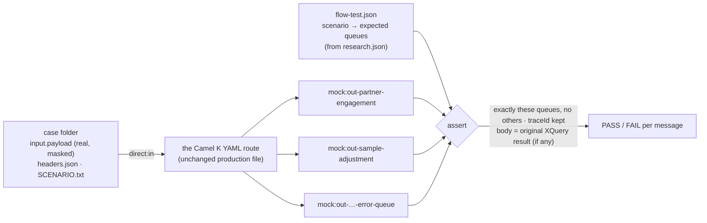

# OSB → Camel K with pi: how it works, what the tests prove, what was tested

Pilot: OSB application `osb-application`, project `sample-change-prj`, proxy
`sample-adjustment`. Status 2026-10-15: **254 tests, 0 failures on the VDI with 751 real masked E2E messages.**

## 1 The chain, and who does what

```mermaid
flowchart LR
  subgraph VDI["Client VDI (nothing below leaves it, except the research pack and reports)"]
    SPL[("Splunk E2E<br/>OSB request logs")] -->|CSV export| T1["task1 / batch_task1.py<br/>mask (HMAC key) · split by flow<br/>scenarios · test cases"]
    OSB[("OSB source<br/>*-prj folders")] --> RP["research_pack.py<br/>facts.json (script)"]
    RP --> PI1["pi agent<br/>skill osb-research<br/>run_research.sh"]
    PI1 --> PACK["research pack<br/>RESEARCH.md · research.json<br/>share check PASS"]
    PACK --> SC["scaffold_camelk.py<br/>route skeleton · FLOW_CARD.md<br/>GENERATED tests"]
    T1 -->|masked real messages| SC
    SC --> AP{{"human approves<br/>FLOW_CARD.md"}}
    AP --> PI2["pi agent<br/>skill osb-camelk-route<br/>run_camelk.sh"]
    PI2 --> MOD["Camel K module<br/>*.camel.yaml + beans<br/>+ error tests"]
    MOD --> MVN["mvn test<br/>(L1, mocks)"]
    MVN --> GATE["check_camelk.py<br/>gates K1–K8"]
    GATE --> MUT["mutate_route.py<br/>route broken on purpose"]
    MUT --> MAT["test_matrix.py<br/>TEST_MATRIX.md"]
  end
  PACK -.->|shareable: no code, hosts, data| NAG["Nagarro review"]
  MAT -.->|counts only| NAG
```

| Step | Tool | Kind | Pilot |
|---|---|---|---|
| Splunk → masked test messages | `task1_log_only.sh` / `batch_task1.py` (domain) | script | 751 messages, 45,331 values masked, residue 0, 29 scenarios |
| OSB source → facts | `research_pack.py` | script | (found and fixed a parser bug: 12c pipeline file not resolved) |
| Facts + source → research pack | **pi** with skill `osb-research`, started by `pi/run_research.sh` | AI agent | PASS, 12 questions answered, 5 open questions |
| Pack → route skeleton, card, **tests** | `scaffold_camelk.py` | script | the parity tests are generated from `research.json`, **not written by an AI** |
| Card approval | a person | human | pending (2 open points) |
| Skeleton → working route + error tests | **pi** with skill `osb-camelk-route`, started by `pi/run_camelk.sh` | AI agent | **pilot route written by Nagarro (Claude) as the reference**; pi does this for the other flows |
| Run, check, prove | `mvn test`, `check_camelk.py`, `mutate_route.py`, `test_matrix.py` | scripts | 254/254, gates PASS (except approval), 9/9 mutations caught |

Why the tests are generated by a script and frozen (gate K5): the agent that writes the route must not also write or
weaken the tests that judge it. The expected results come from the OSB source (research pack) and the inputs from
production-like traffic (Splunk), never from the new Camel code.

Domain, one command per stage: `pi/run_domain.sh <app> auto` (research → task1 → scaffold), approve the cards,
`build`, `matrix`. See [DOMAIN_RUN.md](DOMAIN_RUN.md).

## 2 Are the tests functional? Yes: black-box behaviour of the flow

They do not test Java methods. They send a real message into the route and check what comes out, the way the
consumers of the queues see it.

| Test level | What runs | Proves | Status |
|---|---|---|---|
| **L1** route + mocks (`mvn test`) — **scope of the VDI work** | YAML route in-process, queues = mock endpoints, no Artemis | branching, outputs, headers, body, error handler, retries, log line | ✅ pilot green |
| L2 Dev environment | route on the Dev cluster + real Artemis | subscription filter (selector), durable subscription, fan-out to the other subscribers, redelivery | next phase, on Dev (not on the VDI) |
| L3 replay | built integration, all 751 messages | volume, ordering, no message lost | after L2 |
| UAT shadow | Camel next to OSB on the same traffic | outputs compared message by message | before cut-over |

## 3 Test matrix: pilot `sample-adjustment` (evidence)

### 3.1 Data and research checks

| ID | Check | Evidence | Result |
|---|---|---|---|
| D1 | Export complete: payload logged per message | Splunk 1a/1b; 1,212 lines → 751 unique (63 runs logged twice = duplicate ingestion, `dedup _raw`) | ✅ |
| D2 | Masking: no personal data left | 45,331 values masked, residue check 0 findings on CSV and on 169 fixture files | ✅ |
| D3 | Payload readable | 748 strict JSON + 3 `{[[ … ]]` (raw log identical to masked: our tools did not cause it) | ✅ explained |
| D4 | Every scenario has test messages | 29 scenarios × up to 5 messages = 119 real cases | ✅ |
| R1 | Research pack shareable | share check PASS (no code, hosts, secrets, personal data) | ✅ |
| R2 | Routing understood from source | two independent flag checks, error handler, retries (Q4, Q8, Q9) | ✅ |
| R3 | Scenarios mapped to outputs | every logged scenario matches a mapping row (0 unmapped) | ✅ |

### 3.2 Functional tests on the real messages (L1, VDI 2026-10-15)

| ID | Messages (flags) | In export | Expected (from OSB source) | Result |
|---|---|---|---|---|
| P-main | `hasMainEngagement=true` only | 596 | main queue only | ✅ all cases pass |
| P-partner | `hasPartnerEngagement=true` only | 45 | partner queue only | ✅ |
| P-BOTH | both flags true | 86 | partner **and** main queue | ✅ (open point O1: confirm OSB sends to both) |
| P-NONE | both flags false | 21 | nothing sent (consumed) | ✅ |
| P-BAD | unreadable `{[[` | 3 | error queue | ✅ (assumption O3) |
| P-ALL | 29 scenarios: 124 cases (119 real + 5 synthetic) × 2 tests + 2 generic | 751 | — | **250 run, 0 failed, 124 skipped** (the skipped = body check: this flow forwards the input unchanged, no XQuery output) |

### 3.3 Error handler and behaviour tests (fake values)

| ID | Test | Result |
|---|---|---|
| E1 | any fault → error queue with the original body + errorCode, errorMessage, debugInfo, traceId, resource, eventType | ✅ |
| E2 | main queue send retried 3× (business service retry-count 3), then error queue | ✅ |
| E3 | partner queue send not retried (retry-count 0) | ✅ |
| E4 | traceId generated when missing (like fn-bea:uuid), body forwarded byte for byte | ✅ |
| E5 | unreadable payload → error queue with traceId | ✅ |

### 3.4 Gates and test strength

| ID | Check | Result |
|---|---|---|
| K1 | card approved by a person | ⏳ pending O1/O2 |
| K2–K7 | no gaps, route ids, no hosts/credentials, generated tests unchanged, stubs, error tests ≥ error scopes | ✅ |
| K8 | `mvn test` green | ✅ 254/254 |
| M1–M9 | route broken on purpose (both conditions negated, 3 wrong-queue swaps, 3 dropped outputs, retry removed): tests must fail | ✅ 9/9 caught (run here on the synthetic cases; on the VDI `run_domain.sh … matrix` repeats it on the real ones) |

### 3.5 Not tested yet (and why)

| ID | Gap | Needs |
|---|---|---|
| O1 | both flags true: does OSB really send to both queues (publish) or only one (route)? 86 messages depend on it | `grep` of the pipeline element names |
| O2 | errorCode values: OSB fault codes vs Camel exception names | who reads the error queue |
| O3 | the 3 `{[[` messages: error queue in OSB too? | one run on the OSB test console |
| L2 | selector `resource='Sample Resource' AND eventType='approved'`, durable subscription, fan-out to `peer-flow` | next phase on the Dev environment |
| B | body equality vs original XQuery | not applicable here (identity); applies to flows with transforms |

## 4 The same for the whole domain

`pi/run_domain.sh /e/osb-application matrix` writes `modules/<project>/<proxy>/TEST_MATRIX.md` per flow
(P/E/K/M rows as above, generated from the reports) and `domain/TEST_MATRIX.md`: one row per flow with scenarios
covered, real messages run and failed, error tests, gates, mutations caught. `domain/STATUS.md` shows where each flow
is: research, open questions, test cases, card, gates, tests.
