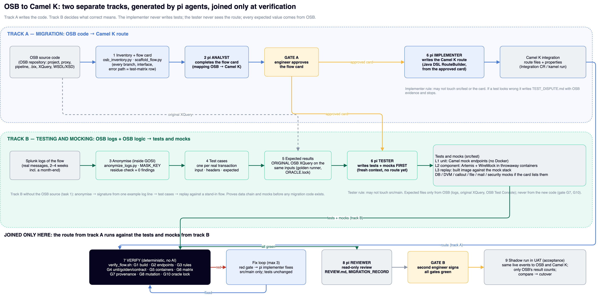

# First two tasks on the VDI (one flow, start small)



Two separate tracks: **A** migrates the OSB code to a Camel K route in YAML DSL (pi implementer), **B** builds the tests and mocks from OSB logs and OSB logic (pi tester). They meet only at verification. Source: `docs/OSB_CamelK_Workflow.drawio`.

Work in a workspace folder, e.g. `~/work/osb-migration`. Tools: `~/Projects/P1` (`git clone git@github.com:PawelWaj/Projects.git ~/Projects`).
Nothing unmasked leaves the VDI. Send only reports and file lists, never CSVs or payloads.

**Start here: [FUNCTIONAL_TESTING.md](FUNCTIONAL_TESTING.md) (approach, mocks, proof, one command per domain).** Step-by-step with the Splunk searches (index `<e2e_index>`): [LOGS_END_TO_END.md](LOGS_END_TO_END.md). All flows in one run: [ALL_FLOWS.md](ALL_FLOWS.md). Source cannot leave the VDI: [RESEARCH_PACK.md](RESEARCH_PACK.md). All proxies of an OSB application, research → Camel K route → green tests: [DOMAIN_RUN.md](DOMAIN_RUN.md). Code generation and comparing skills: [CODEGEN_RUNBOOK.md](CODEGEN_RUNBOOK.md).**

---

## Task 1 — logs only: anonymise, build test cases, replay them through the mocks

**Goal:** prove the data chain and the mock environment on one real flow, before any OSB source or Camel code.
**Input:** a Splunk export of the flow (CSV, columns `_time,_raw`).
**Output:** masked log, test cases, and (with Docker) a replay report.

1. Export from Splunk (2–4 weeks incl. a month-end; one line is enough to start):
   ```
   index=<osb_index> sourcetype=<osb_sourcetype> earliest=-28d@d ("<osb-project>" OR <osb-project-pipeline>*) | sort 0 _time | table _time _raw
   ```
   Save as `work/<flow>/events.csv`.
2. Run:
   ```bash
   export MASK_KEY='<key>'     # private trial: any value; real key: from the data owner
   ~/Projects/P1/vdi-osb-migration/bin/task1_log_only.sh work/<flow>/events.csv work/<flow>/task1
   ```
   It does, in order:
   - **anonymise:** `events.masked.csv` plus a report with no values; must end with `residue findings 0`;
   - **signature from the example line:** stands in for the OSB source;
   - **traces and scenarios:** one scenario per resource type and outcome;
   - **test cases:** `fixtures/parity/<flow>/<scenario>/<traceId>/{input.payload, headers.json, expected.json}`.
3. Check:
   - `task1/events.masked.csv.report.json` → `residue_check.findings` is 0.
   - In `key_inventory`, every key with `masked: false` that could identify a person is added with `--mask-json-key` and the script is rerun (edit `anonymize_logs.py` args in the script, or anonymise by hand first; see RUNBOOK 0a).
   - `task1/traces/scenarios.json` lists the scenarios you expect.
   - `task1/fixtures/**/input.payload` contains no real names or IDs.
4. With Docker/Podman: rerun with `--replay`:
   - It starts Artemis + WireMock + a **stand-in flow** (forwards valid JSON to the success queue) and replays every case.
   - Report: `task1/report/report.json`, one line per case (PASS/FAIL).
   - This proves the mock environment, not the migration.
5. Send back:
   - `events.masked.csv.report.json`
   - `traces/scenarios.json`
   - the fields you added to the masking
   - `report/report.json`, if you ran the replay
   - errors, if any

**Limits of task 1:**
- The signature comes from one example line, not from the OSB source.
- The selector, output queue names and error headers are stand-ins (`_todo` in `replay-config.json`).
- No expected output body yet. That comes from the original XQuery in task 2.

---

## Task 2 — with the OSB source: flow card, real test cases, expected results

**Goal:** the full test basis for the flow, ready for the agent to write the tests and the route.
**Input:**
- the OSB project export from the running OSB (sbconfig `.jar` unzipped, or the JDeveloper project), with shared projects and JARs it uses;
- the **masked** CSV from task 1.

1. Put the export in `osb-src/<project>/`.
2. Preflight:
   ```bash
   bash ~/Projects/P1/vdi-osb-migration/bin/preflight_vdi.sh
   ```
   Fix FAIL lines. Saxon comes from `mvn dependency:get -Dartifact=net.sf.saxon:Saxon-HE:12.9`.
3. Run (the masked file is recognised; no second masking):
   ```bash
   ~/Projects/P1/vdi-osb-migration/bin/start_flow.sh osb-src/<project> <proxy> modules/<proxy> work/<flow>/task1/events.masked.csv
   ```
   - **Inventory and flow card:** `migration/osb-inventory/`, `migration/<proxy>/FLOW_CARD.md`. Every branch, interface and error path is listed, and there's a "referenced but missing" list.
   - **Signatures from the real Log actions:** these replace task 1's example; `work/<proxy>/queries.spl` holds the exact Splunk searches.
   - **Test cases:** `modules/<proxy>/src/test/resources/parity/**`, with `replay-config.json` drafted from the export (real topic, selector, queues; check the `_todo` items).
   - **Expected outputs:** the original XQuery is run on every input, giving `expected-output.xml` and `golden/ORACLE.lock`.
     - A JSON input is reported `oracle-blocked` unless the export contains the nXSD translation.
     - Never hand-write an expected file.
   - **pi analyst:** completes the flow card and stops at **"card not approved"**.
4. Check:
   - "Referenced but missing" in `INVENTORY.md` is empty, or each item has been requested.
   - Every branch on the card has a scenario, or note "no traffic in window".
   - Note how many `oracle-blocked` cases there are.
5. **Do not approve the card yet.** The test and route templates are being switched to Camel K. After that:
   - approve the card;
   - `start_flow.sh … --from pi-test` → tests first, then the Camel K route, gates G1–G10, review.
6. Send back:
   - `FLOW_CARD.md`
   - `INVENTORY.md`
   - `work/<proxy>/traces/coverage.json`
   - `modules/<proxy>/src/test/resources/golden/ORACLE.lock`
   - the preflight output
   - errors, if any

---

## If something stops

| Message | Do |
|---|---|
| `no masking key` | `export MASK_KEY=…` |
| `residue found` | open the report, add the listed field with `--mask-json-key`, rerun |
| `cannot derive the flow id` | `FLOW=<project>/<proxy> bin/task1_log_only.sh …` |
| `internal check failed` (signature) | send the masked example line's structure (no values) to Paweł; try `EXAMPLE_LINE=2` |
| `flow '<name>' not in .../flows` | use the proxy name from `ls migration/osb-inventory/flows` |
| `oracle-blocked` | expected for JSON input without nXSD; the case stays, the body check uses the OSB Test Console later |
| Docker errors in `--replay` | run without `--replay`; the replay can run on a Jenkins agent with Docker |
